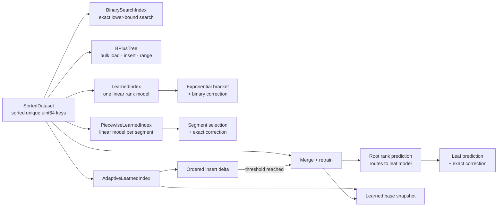

# Concurrent Learned Index

> **An experimental C++20 comparison of exact indexes** for static and
> insert-changing `uint64_t` key sets.

This project studies where a learned index helps and where familiar structures
such as binary search and B+ trees remain a better fit. The learned model only
predicts a search position: every answer is corrected against the data before
it is returned.

**Status:** research prototype · **Build:** CMake · **Tests:** GoogleTest ·
**Benchmarks:** Google Benchmark

## At a glance

| Structure | Lookup | Updates | Range scan | Thread safety |
|---|---|---|---|---|
| Sorted vector + binary search | Exact | Expensive middle inserts | Contiguous scan | Caller-managed |
| B+ tree | Exact | Unique-key insert | Linked-leaf scan | Caller-managed |
| Learned index | Exact, with model correction | Static | — | Caller-managed |
| Piecewise learned index | Exact, with per-segment model correction | Static | — | Caller-managed |
| RMI learned index | Exact, root rank model + routed leaf model | Static | — | Caller-managed |
| Adaptive learned index | Exact, learned base + ordered delta | Insert; synchronous merge/retrain | — | Shared readers; rebuild computation off-lock |

The indexes are in-memory structures. The adaptive index is
insert-only. Rebuild computation runs while readers continue against the
previous base snapshot and current delta; short publication steps still
coordinate through the writer lock. See the
[implementation status](docs/STATUS.md) for scope and remaining work.

## How the pieces fit



The prediction is a hint, never a correctness boundary. The
[architecture notes](docs/architecture.md) explain the lookup and update paths,
threading behavior, and current trade-offs.

## Build and run

Prerequisites: a C++20 compiler, CMake, and Ninja. CMake downloads GoogleTest
and Google Benchmark on the first configure, so that step needs network access.

From PowerShell at the repository root:

```powershell
cmake -S . -B build-release -G Ninja -DCMAKE_BUILD_TYPE=Release
cmake --build build-release
ctest --test-dir build-release --output-on-failure
```

Run the small walkthrough:

```powershell
.\build-release\cpp\learned_index_app.exe
```

Compare global and piecewise learned-model rank error on the deterministic
benchmark shapes (the optional number sets the number of keys per shape):

```powershell
.\build-release\cpp\learned_model_diagnostics.exe 100000
```

Measure signed prediction residuals and absolute rank distance for seeded
existing-key and in-range-missing queries:

```powershell
.\build-release\cpp\learned_correction_diagnostics.exe 100000
```

Rank distance is the gap between the predicted rank and the exact lower-bound
insertion rank. It is a correction-work proxy, not a count of search probes or
a lookup-latency measurement.

## Benchmarking

The suite covers exact membership, model training, B+ tree bulk load, batches
of 64 inserts, synchronous adaptive rebuilds, and inclusive range scans. Key
shapes include random 64-bit, evenly spaced, clustered, and quadratic-gap
datasets. Missing-key cases distinguish out-of-range misses from queries in
actual gaps. Hot-query cases compare all five static lookup indexes with 90%
of requests drawn from a fixed 1% hot-key set.

Run the complete suite and save its raw output:

```powershell
.\build-release\cpp\learned_index_benchmarks.exe `
  --benchmark_out=run-results.csv `
  --benchmark_out_format=csv
```

Measure the adaptive index under simultaneous readers and one inserting writer
(arguments are reader count, initial key count, and number of inserted keys):

```powershell
.\build-release\cpp\adaptive_concurrency_benchmark.exe 4 100000 2500
```

The tool prints one CSV header and result row, including aggregate reader
throughput, ordinary writer insert latency, and latency for insertions that
trigger a rebuild. Each reader warms the lookup path before the timed phase.
See [Trial 011](docs/experiments/trial-011-adaptive-concurrency.md) for the
first repeated sample and its limitations.

### What the first measurements say

The first 100K-key B+ tree trial had lower median membership and 64-key insert
times than the sorted-vector baselines; the vector was faster for a 128-key
range scan. In later random-key lookup samples, B+ tree led at 100K keys, the
learned index and B+ tree were close at 1M, and the learned index was lower at
10M. On evenly spaced keys, the learned model was much faster; on quadratic-gap
keys it needed substantially more correction.

These are exploratory measurements from one machine and short runs, with
noticeable variation in some cases. They do not establish a general winner.
The measured medians, raw CSVs, machine details, and caveats are preserved in
the [experiment log](docs/experiments/README.md). Start with
[Trial 001: B+ tree baseline](docs/experiments/trial-001-b-plus-tree-baseline.md)
or browse the [full trial index](docs/experiments/README.md). The initial
[hot-query trial](docs/experiments/trial-007-hot-query-workload.md) includes
its raw measurements and limits. The first piecewise-model trial shows lower
prediction error and faster lookup on quadratic-gap keys, with higher training
cost and slower lookups on several other shapes; see
[Trial 008](docs/experiments/trial-008-piecewise-learned-index.md). The first
RMI implementation is exact, but its initial comparison did not show a lookup
advantage and its training was slower; see
[Trial 010](docs/experiments/trial-010-rmi-index.md).

## Repository guide

```text
cpp/include/learned_index/   public data types and index interfaces
cpp/src/                     index implementations
cpp/tests/                   correctness and concurrency tests
cpp/benchmarks/              reproducible workload definitions
docs/STATUS.md               implemented scope and open work
docs/architecture.md         diagrams and behavior notes
docs/experiments/            trial write-ups and raw benchmark output
```

## Current limits

- The global learned index remains the baseline. The optional piecewise model
  uses a fixed target segment size that has not been tuned across datasets;
  skew and hot-query behavior still need broader measurement.
- The initial RMI is static, uses fixed-size rank leaves, and has not shown a
  performance advantage in the first comparison. Its leaf-size and memory
  trade-offs remain open.
- Adaptive rebuild thresholds are configured manually. The writer that
  triggers a rebuild waits for merge and training to finish, while readers
  continue against the old snapshot and delta. A newer snapshot is published
  under the lock after training.
- Updates support insertion only. Deletion, persistence, crash recovery,
  concurrent B+ tree access, and lock-free reads are not implemented.
- Concurrent correctness covers multiple readers and writers during repeated
  rebuilds. Concurrent throughput, writer latency, rebuild latency, and
  race-detector runs remain open. The static RMI and B+ tree are not
  thread-safe interfaces.

The project is complete only as an evolving prototype. The broader research
work is still in progress; consult the [status and next steps](docs/STATUS.md)
before interpreting results or extending claims.
