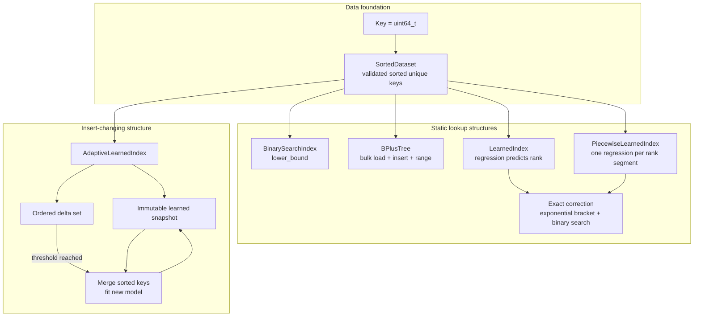
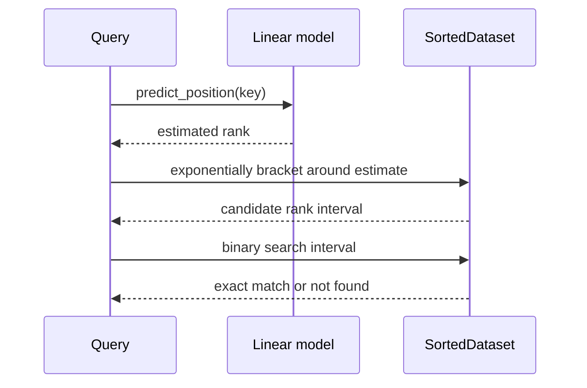
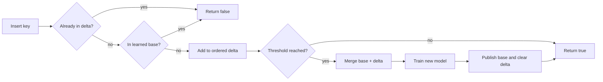

# Architecture and behavior

The code compares four in-memory ways to answer exact membership queries over
unique unsigned 64-bit keys. The common test and benchmark contract is
`contains(key) -> bool`; the binary-search adapter and learned index also
expose positions.

## Structure map

The `Index` concept describes the shared exact-membership interface. It does
not imply that every structure has the same update or range-query behavior.

## Learned lookup

Prediction error changes how much correction work is needed, but does not
change the answer. A poor fit can make this implementation slower than plain
binary search; the error report and benchmark trials document that trade-off.
The global model borrows its `SortedDataset`, which must outlive it. The
piecewise alternative stores one small model per contiguous rank segment and
selects a segment by its last key before predicting within that segment. It
also borrows the dataset and performs exact correction, so a segment boundary
or imperfect fit cannot change membership correctness. More segments can
reduce model error but add model storage, routing work, and training time; the
segment size is configurable and has not yet been tuned beyond the initial
comparison in Trial 008.

## Adaptive updates

The adaptive index owns an immutable sorted base plus an ordered set of recent
inserts. A lookup checks the delta and then the learned base. An insert first
rejects duplicates across both parts, adds a new key to the delta, and starts a
full merge/retrain when the configured count threshold is reached.

The implementation protects reads with a shared mutex lock and updates with
an exclusive lock. Multiple lookups may proceed together. Inserts and the
entire rebuild block lookups; this is correctness-oriented synchronization,
not a lock-free or latency-optimized design.

## B+ tree behavior

The B+ tree keeps values in sorted leaf nodes and copies each non-leftmost
child's minimum key into its parent as a separator. Leaves link forward for
inclusive range scans. Bulk loading groups a validated sorted dataset into
balanced levels; incremental inserts split full leaves and internal nodes.
`validate()` checks ordering, occupancy, separators, equal leaf depth, leaf
links, and total size. The structure is currently single-threaded and has no
delete, persistence, or crash-recovery path.

## Source map

| Area | Location |
|---|---|
| Key and sorted data | `cpp/include/learned_index/data/` |
| Public index interfaces | `cpp/include/learned_index/index/` |
| Implementations | `cpp/src/index/` |
| Tests | `cpp/tests/` |
| Benchmark workloads | `cpp/benchmarks/` |
| Trial records and raw data | `docs/experiments/` |

For current verification results and open limitations, see
[`STATUS.md`](STATUS.md). For measurements, see the
[experiment index](experiments/README.md).
