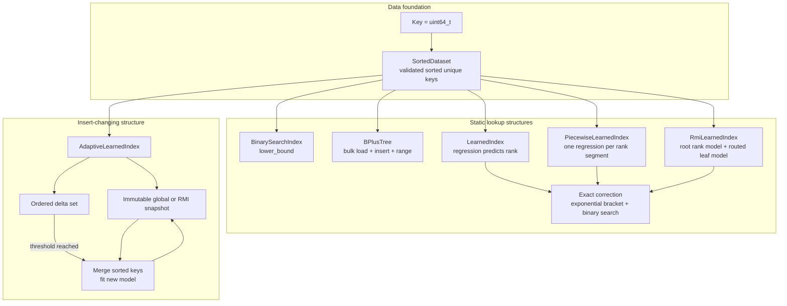
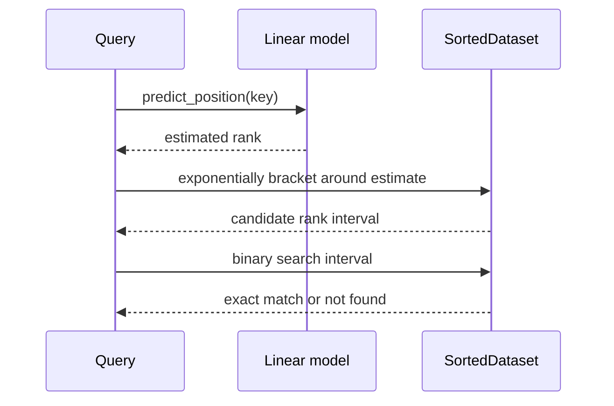
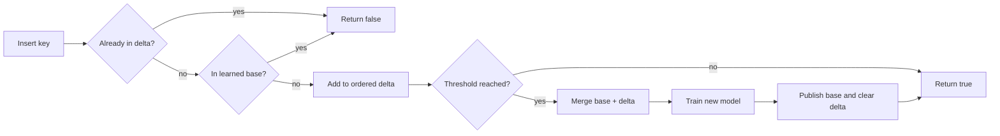

# Architecture and behavior

The code compares several in-memory ways to answer exact membership queries
over unique unsigned 64-bit keys. The common test and benchmark contract is
`contains(key) -> bool`; the binary-search adapter and learned index also
expose positions.

## Structure map

The `Index` concept describes the shared exact-membership interface. It does
not imply that every structure has the same update or range-query behavior.

## Learned lookup

Prediction error changes how much correction work is needed, but does not
change the answer. A poor fit can make this implementation slower than plain
binary search; the error report and benchmark trials document that trade-off.
The global model borrows its `SortedDataset`, which must outlive it. The
piecewise alternative stores one small model per contiguous rank segment and
selects a segment by its last key before predicting within that segment. It
also borrows the dataset and performs exact correction, so a segment boundary
or imperfect fit cannot change membership correctness. More segments can
reduce model error but add model storage, routing work, and training time; the
segment size is configurable and has not yet been tuned beyond the initial
comparison in Trial 008.

The two-stage RMI uses its root regression to estimate a global rank and
select one equal-rank leaf model. That leaf predicts a candidate position.
Unlike the piecewise index, routing is learned from the root prediction rather
than selected by searching segment key boundaries. The final correction may
search the full dataset, so a routing error cannot produce a false membership
answer. The target leaf size is configurable. Trial 010's initial static lookup
comparison showed no RMI performance win. Trial 014 compared adaptive rebuild
costs at four leaf sizes across four shapes and found no consistent winner;
static lookup latency and model memory by leaf size still need measurement.

`learned_correction_diagnostics` compares each model's predicted rank with the
exact lower-bound insertion rank for seeded hits and in-range misses. The
signed difference shows prediction bias; its absolute value is a rank-distance
proxy for correction work. It does not count array probes or replace latency
benchmarks. Trial 009 records the first sample and its limitations.

## Adaptive updates

The adaptive index owns an immutable sorted base plus an ordered set of recent
inserts. A lookup checks the delta and then the learned base. An insert first
rejects duplicates across both parts, adds a new key to the delta, and starts a
full merge/retrain when the configured count threshold is reached.

The implementation protects lookups and updates with a shared mutex. Multiple
lookups may proceed together. An insert that reaches the threshold captures a
shared pointer to the current immutable snapshot and copies the pending delta
while holding the writer lock. It then merges and trains a replacement
snapshot without holding the lock. Other lookups continue to query the old
snapshot plus the full delta; other inserts can append to that delta while the
training proceeds. Publication swaps in the trained snapshot and erases only
the keys included in that build, keeping later inserts visible in the delta.
If those later inserts already meet the threshold, the publishing writer
starts another build.

This shortens the exclusive-lock window, but it does not make rebuilding
asynchronous from the triggering writer: that insert waits for merge/training
and publication. Lookup still takes a shared lock, and this is neither
lock-free nor a measured latency guarantee. Concurrent performance and
race-detector checks remain future work.

`AdaptiveLearnedIndex` supports three policies: `ModelKind::global` (the
default), `ModelKind::rmi`, and `ModelKind::automatic`. Manual policies persist
through every rebuild. Automatic mode trains both candidates on the merged
snapshot, samples up to 256 evenly spaced key positions, and compares mean
absolute rank prediction error. It publishes the RMI only if its sampled error
is at least 20% lower; otherwise it publishes the global model. The active
choice is observable through `selected_model_kind()` and can change after a
later rebuild. Exact correction remains inside each model lookup.

This first automatic policy is deliberately simple and deterministic. It uses
data-fit error as a proxy; it does not estimate query frequency, training cost,
or model memory. Trials 013–014 record its choices and rebuild costs across
different insert batches and key shapes; the final selected model can change as
the base changes. Trials 011–012 record the earlier manual global/RMI
comparisons.

## B+ tree behavior

The B+ tree keeps values in sorted leaf nodes and copies each non-leftmost
child's minimum key into its parent as a separator. Leaves link forward for
inclusive range scans. Bulk loading groups a validated sorted dataset into
balanced levels; incremental inserts split full leaves and internal nodes.
`validate()` checks ordering, occupancy, separators, equal leaf depth, leaf
links, and total size. The structure is currently single-threaded and has no
delete, persistence, or crash-recovery path.

## Source map

| Area | Location |
|---|---|
| Key and sorted data | `cpp/include/learned_index/data/` |
| Public index interfaces | `cpp/include/learned_index/index/` |
| Implementations | `cpp/src/index/` |
| Tests | `cpp/tests/` |
| Benchmark workloads | `cpp/benchmarks/` |
| Trial records and raw data | `docs/experiments/` |

For current verification results and open limitations, see
[`STATUS.md`](STATUS.md). For measurements, see the
[experiment index](experiments/README.md).
